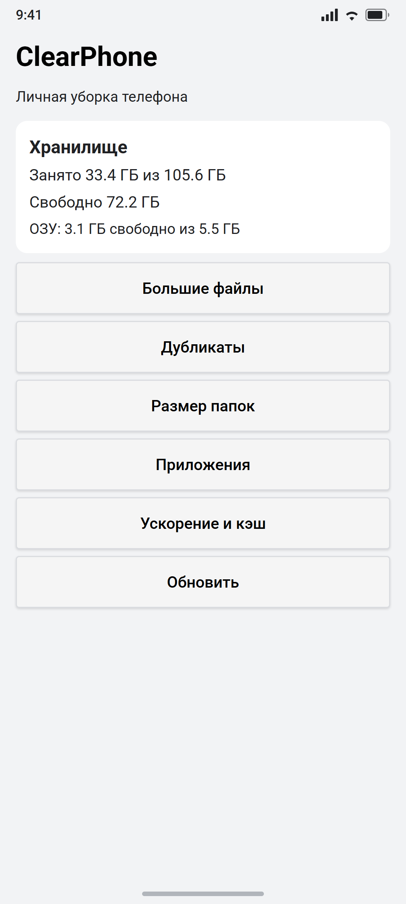

# ClearPhone

Простой Android-чистильщик без рекламы, аналитики и интернета. Показывает, что занимает место, помогает удалить большие файлы и дубликаты, а через [Shizuku](https://shizuku.rikka.app/) умеет чистить кэш и останавливать фоновые приложения.

<p align="center">
  
</p>
<p align="center"><sub>Главный экран. Изображение — макет, отрисованный по реальному коду интерфейса (<code>docs/screenshot.html</code>).</sub></p>

## Возможности

| Раздел | Что делает | Нужен Shizuku |
|---|---|---|
| **Большие файлы** | Находит файлы от 20 МБ (топ-300 по размеру), открывает через системный просмотрщик или удаляет | нет |
| **Дубликаты** | Ищет одинаковые файлы по размеру и MD5 (от 64 КБ), показывает группы и освобождаемое место | нет |
| **Размер папок** | Рекурсивно считает размер папок в корне хранилища | нет |
| **Приложения** | Список пользовательских приложений с размерами, удаление и переход в настройки | нет |
| **Ускорение и кэш** | `pm trim-caches`, `am kill-all`, отключение рекламных модулей MIUI/Facebook, `bg-dexopt`, анимации 0.5x | да |
| **Главный экран** | Занято/свободно в хранилище, доступная ОЗУ, быстрый переход в разделы | нет |

Приложение работает полностью локально: в манифесте нет разрешения `INTERNET`.

- Минимальная версия: Android 8.0 (API 26)
- Целевая версия: Android 14 (API 34)
- Пакет: `com.playtim.clearphone`
- Текущая версия: **1.2** (versionCode 3)
- Размер APK: ~53 КБ (весь UI программный, без картинок и библиотек)

## Установка

1. Скачайте `ClearPhone-1.2.apk` со страницы [Releases](../../releases/latest).
2. На телефоне разрешите установку из неизвестных источников для файлового менеджера или браузера.
3. Откройте APK и установите.
4. Запустите ClearPhone и выдайте **«Доступ ко всем файлам»** — без него не работают поиск больших файлов и дубликатов. Кнопка запроса есть на главном экране.
5. Для размеров приложений дополнительно включите **«Доступ к истории использования»** (кнопка появится в разделе «Приложения»).

APK лежит и в репозитории: [`releases/ClearPhone-1.2.apk`](releases/ClearPhone-1.2.apk).

> **Важно:** удаление файлов необратимо. Приложение спрашивает подтверждение, но резервной копии не делает.

## Shizuku (необязательно)

Раздел «Ускорение и кэш» использует Shizuku, чтобы выполнять shell-команды без root.

1. Установите [Shizuku](https://shizuku.rikka.app/) (проверено на 13.6.0).
2. Запустите сервер Shizuku через беспроводную отладку или ADB.
3. В ClearPhone откройте «Ускорение и кэш» → «Запросить доступ Shizuku» → «Разрешить».

Подробная инструкция и команды для запуска сервера: [`docs/shizuku.md`](docs/shizuku.md).

Без Shizuku приложение продолжает работать: доступны большие файлы, дубликаты, папки и приложения.

## Сборка из исходников

Проект собирается без Gradle — напрямую `aapt2`, `javac`, `d8`, `zipalign` и `apksigner`.

### Что нужно

- JDK 17
- Android SDK Build-Tools 35.0.0
- `android.jar` для API 35
- Java-стабы Shizuku **13.1.0** (в более новых удалён `Shizuku.newProcess()`, который использует приложение)

`build.ps1` ожидает такую структуру:

```text
tools/
  jdk/jdk-17.0.20.1+1/
  bt/android-15/                    # Build-Tools 35.0.0
  platform/android-35/android.jar
  shizuku/
    api-13.1.0-x/classes.jar
    aidl-13.1.0/classes.jar
    shared-13.1.0/classes.jar
    provider-13.1.0/classes.jar
    annotation-1.3.0.jar
```

Папка `tools/` не входит в репозиторий из-за размера.

### Сборка

```powershell
# только APK
powershell -ExecutionPolicy Bypass -File .\build.ps1

# APK + установка на подключённый телефон через ADB
powershell -ExecutionPolicy Bypass -File .\build.ps1 -Install
```

Результат: `app\build\ClearPhone.apk`.

### Подпись

Скрипт использует `clearphone.jks` из корня. Если файла нет, он создаст новый ключ с паролями `clearphone` (alias `clearphone`).

Для обновления уже установленного приложения нужен **тот же ключ**, которым подписан релиз. Если собрать APK с новым ключом, Android не даст установить его поверх старого — придётся удалить приложение.

Ключ релиза в репозиторий не добавляется. Для собственных сборок создайте свой keystore и подписывайте им.

## Структура проекта

```text
app/
  AndroidManifest.xml                 манифест, разрешения, провайдеры
  src/com/playtim/clearphone/
    MainActivity.java                 весь UI и логика
    FileContentProvider.java          read-only content:// для открытия файлов
build.ps1                             сборка, подпись, установка
docs/
  screenshot.png                      изображение главного экрана
  screenshot.html                     исходник макета
  shizuku.md                          настройка Shizuku
releases/
  ClearPhone-1.2.apk                  готовый установщик
scan_storage.sh                       вспомогательный скрипт диагностики хранилища
```

## Разрешения

- `MANAGE_EXTERNAL_STORAGE` — поиск и удаление файлов во внешнем хранилище.
- `QUERY_ALL_PACKAGES` — список установленных приложений.
- `PACKAGE_USAGE_STATS` — размеры приложений через `StorageStatsManager`.
- `moe.shizuku.manager.permission.API_V23` — доступ к Shizuku.

`FileContentProvider` отдаёт только чтение, только внутри основного внешнего хранилища и только по явно выданному URI-разрешению.

## Лицензия

[MIT](LICENSE)
